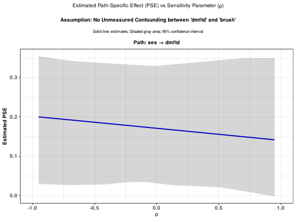

# gmediation

<!-- badges: start -->
<!-- badges: end -->

`gmediation` conducts causal mediation and path analysis for multiple
mediators arranged in up to two stages.

- `gmediate()` estimates individual path effects, first- and second-stage
  mediator effects, and the total exposure effect, with bootstrap
  confidence intervals.
- `gmedsens()` extends `gmediate()` with a probabilistic sensitivity
  analysis for path effects that are not identifiable from the data alone.

## Installation

```r
install.packages("gmediation")
```

or, for the development version, from source:

```r
install.packages("gmediation_2.0.0.tar.gz", repos = NULL, type = "source")
```

## Example

```r
library(gmediation)

model.y1 <- glm(dmftd ~ ses + grpvlb + grpbpd + race + SEX + brush + seal,
                 family = binomial, data = dental)
model.m11 <- glm(brush ~ ses + grpvlb + grpbpd + race + SEX,
                  family = binomial, data = dental)
model.m21 <- glm(seal ~ ses + grpvlb + grpbpd + race + SEX + brush,
                  family = binomial, data = dental)

single <- gmediate(data = dental, model.m1 = list(model.m11),
                    model.m2 = list(model.m21), model.y = model.y1,
                    expos = c("ses", 1), seed = 1234, boots = 100,
                    cluster = NULL, decomp = 1, CIPCT = 95,
                    xcorrv = c(0, 0.9), refmult = 1)
single          # printing is explicit: assigned results do not print by themselves
```

### Sensitivity analysis with `gmedsens()`

Some path effects rely on an untestable assumption of no unmeasured
confounding between two mediators, or between a mediator and the response.
`gmedsens()` re-evaluates the affected path effects over a grid of assumed
correlations (`xcorrv`) between the corresponding residuals. It takes the
same models and arguments as `gmediate()`, plus optional `plot_out` and
`table_out` arguments to save the sensitivity plots (one PDF) and tables
(CSV files):

```r
out_dir <- file.path(tempdir(), "gmedsens_example")

gmedsens(data = dental, model.m1 = list(model.m11),
         model.m2 = list(model.m21), model.y = model.y1,
         expos = c("ses", 1), seed = 1234, boots = 100,
         cluster = NULL, decomp = 1, CIPCT = 95,
         xcorrv = c(0, 0.5, 0.9), refmult = 1,
         plot_out = c("true", out_dir), table_out = c("true", out_dir))
```

Unlike `gmediate()`, `gmedsens()` prints its report when it finishes even if
you assign the result: it lists the CSV tables and the PDF that were written
and where. Add `print_report = FALSE` to suppress it. The returned object
holds the tables (`path`, `first.stage`, `second.stage`) and can be redrawn with
`plot()`.

This call takes about one to two minutes. Each plot shows an estimated
path-specific effect, with its confidence band, against the sensitivity
parameter; the example below is the first page of the PDF.



See `vignette("gmediate", package = "gmediation")` and
`vignette("gmedsens", package = "gmediation")` for full worked examples.

## What is new in 2.0.0

Refactored internals, S3 classes with `print()` / `plot()` methods, bug fixes
(RR scale, negative-binomial dispersion, binary second-stage mediators in
`gmedsens()`, missing-value handling), fewer dependencies and a test suite.
Assigned `gmediate()` results no longer print automatically. See `NEWS.md`
for all changes and the numbers they affect.

## Development notes

This package was built and checked with `R CMD check` (R 4.3.3, Linux);
see `BUILD_INSTRUCTIONS.md` for the steps to repeat the checks on your own
machine (including the checks that need internet access) before submitting
to CRAN.
