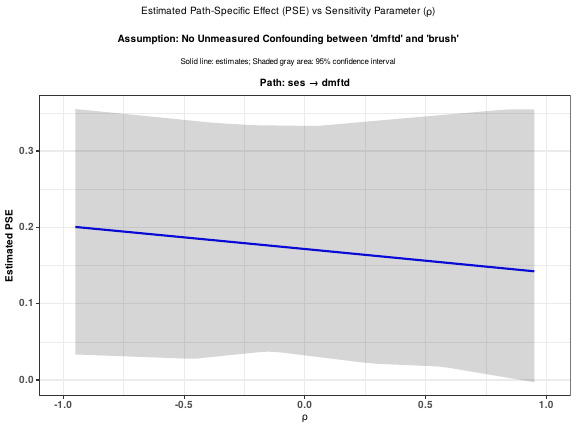
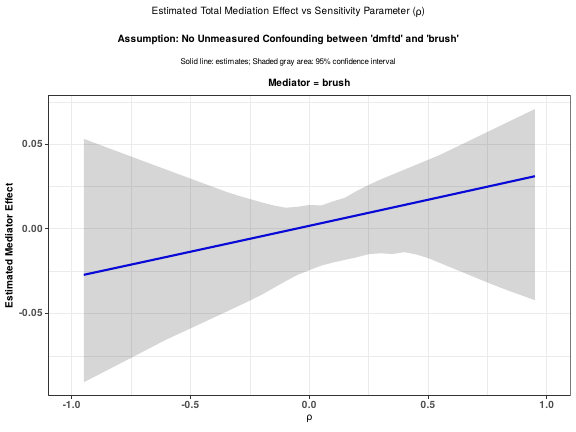

```{r, include = FALSE}
knitr::opts_chunk$set(
  collapse = TRUE,
  comment = "#>",
  fig.width = 7,
  fig.height = 5
)
```

## Introduction

`gmedsens()` is the sensitivity-analysis companion of `gmediate()` in the
`gmediation` package. Like `gmediate()`, it conducts causal mediation/path
analysis for multiple mediators in two stages: it estimates the individual
path effects from an exposure X to a response Y through one or more
first-stage mediators (e.g. `m11`, `m12`) and one or more second-stage
mediators (e.g. `m21`, `m22`), together with bootstrap confidence intervals.

Some path effects, however, can only be identified under an assumption that
cannot be tested with the observed data: that there is no unmeasured
confounding between two of the mediators, or between a mediator and the
response. `gmedsens()` relaxes that assumption. It re-evaluates the affected
path effects across a grid of assumed correlations (the sensitivity parameter
$\rho$ between the residuals of the two variables concerned), so that you can
see how far the substantive conclusions depend on it. Results are reported as
sensitivity plots and tables, which can optionally be saved to a PDF file and
to CSV files.

## Install and load the package

### Installing the package

Install directly from CRAN:

```r
install.packages("gmediation")
```

or, from a local source tarball:

```r
install.packages("gmediation_2.0.0.tar.gz", repos = NULL, type = "source")
```

### Loading the package

```{r setup}
library(gmediation)
```

## Example data

The examples in this vignette use the built-in `dental` data, which loads
automatically with the package (there is no need to call `data(dental)`
manually). There are 13 variables in the dataset, for 205 children.

```{r}
head(dental, 10)
```

| Variable | Type      | Definition                                                          |
| -------- | --------- | -------------------------------------------------------------------- |
| ID       | character | permuted subject ID                                                   |
| dmft     | numeric   | count of decayed, missing, or filled teeth                            |
| SEX      | binary    | 1 if male; 0 if female                                                |
| grpbpd   | binary    | 1 if BPD (bronchopulmonary dysplasia); 0 otherwise                    |
| grpvlb   | binary    | 1 if VLBW (very low birth weight); 0 otherwise                        |
| brush    | binary    | 1 if brushes at least twice per day; 0 otherwise (1st-stage mediator) |
| visit    | binary    | 1 if taken to the dentist at most once per year; 0 otherwise (1st-stage mediator) |
| dmftd    | binary    | 1 if dmft is greater than 0; 0 if dmft equals 0 (outcome)             |
| seal     | binary    | 1 if has at least one dental sealant; 0 otherwise (2nd-stage mediator)|
| ses      | binary    | 1 if low socioeconomic status; 0 otherwise (exposure)                 |
| race     | binary    | 1 if African American; 0 otherwise                                    |
| ohi      | numeric   | Oral Hygiene Index, 0-3, higher is worse (2nd-stage mediator)         |
| momid    | character | permuted maternal ID; usable as a cluster variable                    |

## Reference group default

Like `gmediate()`, `gmedsens()` takes a `ref` argument that defines the
empirical baseline covariate distribution used in the mediation formula. The
default is `ref = "entire sample"`, meaning the whole complete-case sample is
used as the reference group unless a different reference group is explicitly
requested, e.g. `ref = c("ses", c(0, 1))` to restrict to individuals with
`ses` equal to 0 or 1. In the examples below we rely on this default.

## Note on running time

`gmedsens()` repeats the bootstrap analysis over the whole grid of assumed
correlations and for every pair of assumption variables, so a call with
`boots = 100` takes about one to one and a half minutes. To keep this
vignette quick to build, the code chunks that call `gmedsens()` are shown but
not run; the output displayed after each of them was produced by running that
code. The model-fitting steps are run as usual.

## `gmedsens()`: Example 1 (one mediator per stage)

In this example we assess the sensitivity of the mediation/path analysis
explaining the effect of `ses` on `dmftd`, using one first-stage mediator
(`brush`) and one second-stage mediator (`seal`).

First, fit models for the response variable and each mediator, exactly as for
`gmediate()`. In this example, `ses` is the exposure and `grpvlb`, `grpbpd`,
`race`, `SEX` are covariates. Because `dmftd`, `seal`, and `brush` are all
binary, a logistic model is used for each.

```{r}
model.y1 <- glm(dmftd ~ ses + grpvlb + grpbpd + race + SEX + brush + seal,
                 family = binomial, data = dental)
model.m11 <- glm(brush ~ ses + grpvlb + grpbpd + race + SEX,
                  family = binomial, data = dental)
model.m21 <- glm(seal ~ ses + grpvlb + grpbpd + race + SEX + brush,
                  family = binomial, data = dental)
```

The fitted models are then passed into `gmedsens()`. Here the plots and
tables are saved to a temporary folder; replace `tempdir()` with a folder of
your choice to keep them.

```{r, eval = FALSE}
out_dir <- file.path(tempdir(), "gmedsens_example1")
gmedsens(data = dental, model.m1 = list(model.m11),
         model.m2 = list(model.m21), model.y = model.y1,
         expos = c("ses", 1), seed = 1234, boots = 100,
         cluster = NULL, decomp = 1, CIPCT = 95,
         xcorrv = c(0, 0.5, 0.9), refmult = 1,
         plot_out = c("true", out_dir), table_out = c("true", out_dir))
```

Arguments used above:

- `data = dental` : `dental` is used as the original data
- `model.m1 = list(model.m11)` : the model fit for the first-stage mediator
- `model.m2 = list(model.m21)` : the model fit for the second-stage mediator
- `model.y = model.y1` : the model fit for the response
- `expos = c("ses", 1)` : `ses` is the exposure variable and `ses = 1` is
  the exposed group / `ses = 0` is the unexposed group
- `ref` : not specified, so the default `"entire sample"` is used
- `seed` : the seed used for bootstrap samples
- `boots` : number of bootstrap samples used for the confidence interval
- `cluster` : if the data has clusters, the cluster variable can be used to
  get cluster bootstrap samples (not used in this example, so standard
  bootstrap sampling of individuals is conducted)
- `decomp` : two choices of decomposition are available, characterized as an
  ordering to define path effects. Decomposition 1 is used here
- `CIPCT` : confidence level used for the bootstrap confidence interval
- `xcorrv` : the grid of assumed correlations evaluated for the
  second-stage mediator paths (the sensitivity parameter $\rho$ itself is
  varied over $-0.95$ to $0.95$ along the horizontal axis of each plot)
- `refmult` : the reference group multiplier; reference group samples are
  duplicated by this factor in the mediation formula computation to reduce
  Monte Carlo error
- `plot_out`, `table_out` : where to save the plots (one PDF file) and the
  tables (CSV files); see "Saving tables and plots" below

When the object is printed, the console shows the title of each page of the PDF, followed by a summary of the
settings used (abbreviated here; this example produces 22 pages):

```
#> ----------------------------------------
#> PDF Page 1
#> Estimated Path-Specific Effect (PSE) vs Sensitivity Parameter (rho)
#> Assumption: No Unmeasured Confounding between 'dmftd' and 'brush'
#>   Path: ses -> dmftd
#> ----------------------------------------
#> ...
#> ----------------------------------------
#> Exposure ('exposed' value): ses(1)
#> Final Outcome: dmftd
#> Sample Size Used: 205
#> Number of Bootstrap Samples / Number Used: 100 / 100
#> Reference Group: Whole Sample, refmult: 1
#> Scale: MeanDiff
#> Confidence Interval Percentage: 95
#> g (between-correlation factor): 1
#> ----------------------------------------
#> Tables saved to:
#>   <out_dir>/gmedsens_pathspec_out.csv
#>   <out_dir>/gmedsens_firststage_out.csv
#>   <out_dir>/gmedsens_secondstage_out.csv
#> Plots saved to: <out_dir>/gmedsens_all_plots.pdf
```

With the default `assumvars = "ALL"`, one set of plots is produced for each
pair of variables whose lack of unmeasured confounding is assumed. Here the
pairs are `dmftd` & `brush`, `dmftd` & `seal`, and `seal` & `brush`. For
each pair the PDF shows

- the estimated path-specific effects (PSE) against $\rho$, and
- the estimated total mediation effect of each mediator against $\rho$,

with a solid line for the estimate and a shaded band for the confidence
interval. For example, the first page shows the path effect of `ses` on
`dmftd` that is not mediated by either mediator, under the assumption of no
unmeasured confounding between `dmftd` and `brush`:

```{r, echo = FALSE, out.width = "90%", fig.alt = "Estimated path-specific effect of ses on dmftd against the sensitivity parameter rho, with a shaded confidence band."}

```

and the fifth page shows the total mediation effect of `brush`:

```{r, echo = FALSE, out.width = "90%", fig.alt = "Estimated total mediation effect of brush against the sensitivity parameter rho, with a shaded confidence band."}

```

A mediation effect whose confidence band stays on one side of zero for all
plausible values of $\rho$ is robust to the un-testable assumption. If the
band includes zero (as for `brush` here, where the band includes zero over
the whole range and the estimate changes sign near $\rho = 0$), the
conclusion depends on it.

## `gmedsens()`: Example 2 (two mediators per stage)

Here we assess the sensitivity of the effect of `ses` on `dmftd` using two
first-stage mediators (`brush`, `visit`) and two second-stage mediators
(`seal`, `ohi`).

```{r}
model.y2 <- glm(dmftd ~ ses + grpvlb + grpbpd + race + SEX + brush + visit +
                   seal + ohi, family = binomial, data = dental)
model.m11 <- glm(brush ~ ses + grpvlb + grpbpd + race + SEX,
                  family = binomial, data = dental)
model.m12 <- glm(visit ~ ses + grpvlb + grpbpd + race + SEX,
                  family = binomial, data = dental)
model.m21 <- glm(seal ~ ses + grpvlb + grpbpd + race + SEX + brush + visit,
                  family = binomial, data = dental)
model.m22 <- glm(ohi ~ ses + grpvlb + grpbpd + race + SEX + brush + visit,
                  family = gaussian, data = dental)
```

```{r, eval = FALSE}
out_dir <- file.path(tempdir(), "gmedsens_example2")
gmedsens(data = dental, model.m1 = list(model.m11, model.m12),
         model.m2 = list(model.m21, model.m22), model.y = model.y2,
         expos = c("ses", 1), seed = 443095, boots = 100,
         cluster = "momid", decomp = 2, CIPCT = 95,
         xcorrv = c(0, 0.5, 0.9), scale = "MeanDiff",
         assumvars = c("dmftd", "ohi"), g = 1, ndig = 4,
         n_rows = 1, n_cols = 1, rows_per_page = 18, maxcnt = 100,
         plot_out = c("true", out_dir), table_out = c("true", out_dir))
```

The meaning of the arguments shared with Example 1 is unchanged. Here we
call in two first-stage and two second-stage mediators, use `seed = 443095`,
and use decomposition option 2. The arguments that are new in this example
are:

- `cluster = "momid"` : `momid` identifies each child's mother; bootstrap
  resampling is performed by resampling mothers (clusters) with
  replacement, so that all children of a sampled mother are included together
- `scale = "MeanDiff"` : the scale on which the effects are summarized
  (mean difference)
- `assumvars = c("dmftd", "ohi")` : restricts the sensitivity evaluation to
  the assumption of no unmeasured confounding between `dmftd` and `ohi`,
  instead of every applicable pair (`"ALL"`, the default). This keeps the
  run time and the number of pages down
- `g` : a scaling factor applied to the assumed between-mediator /
  mediator-outcome correlation grid
- `ndig`, `n_rows`, `n_cols`, `rows_per_page` : control the number of
  digits shown and the layout of the sensitivity tables and plots on each
  page
- `maxcnt` : the maximum number of iterations allowed in the internal
  root-finding routines
- `deltsi`, `tol`, `tolx` (not used here) : numerical tolerances for the
  same calculations; the defaults are suitable for most analyses

The console output has the same form as in Example 1 and reports five PDF
pages for this analysis.

## Saving tables and plots

The two output arguments each take a vector of length two: the first
element is `"true"` or `"false"` (the default), and the second is the folder
in which to write the files. The folder is created if it does not exist.

- `plot_out = c("true", folder)` writes every sensitivity plot, in order,
  to a single file, `gmedsens_all_plots.pdf`.
- `table_out = c("true", folder)` writes the sensitivity tables as CSV
  files: `gmedsens_pathspec_out.csv` (individual path effects),
  `gmedsens_firststage_out.csv` (first-stage mediators) and
  `gmedsens_secondstage_out.csv` (second-stage mediators). A file is only
  written when its table is not empty; in Example 2, for instance, no
  first-stage file is produced.

Reading the files back into R, Example 2 gives:

```{r, eval = FALSE}
head(read.csv(file.path(out_dir, "gmedsens_pathspec_out.csv")), 5)
```

```
#>                Path Xcorr     ρ Estimate Lower.CI Upper.CI Rho.Between
#> 1 ses → ohi → dmftd    NA -0.95   0.4378   0.1295   0.5834 dmftd & ohi
#> 2 ses → ohi → dmftd    NA -0.90   0.3376   0.0912   0.4997 dmftd & ohi
#> 3 ses → ohi → dmftd    NA -0.85   0.2798   0.0734   0.4402 dmftd & ohi
#> 4 ses → ohi → dmftd    NA -0.80   0.2408   0.0622   0.3921 dmftd & ohi
#> 5 ses → ohi → dmftd    NA -0.75   0.2118   0.0543   0.3536 dmftd & ohi
```

Each row gives the estimate and its confidence limits for one path (or
mediator) at one value of $\rho$ (`ρ`), and `Xcorr` is the assumed
correlation from `xcorrv` for second-stage paths. When `assumvars = "ALL"`
(the default), every pair of assumption variables is evaluated and the files
stack the results for all pairs; the `Rho.Between` column identifies the pair
each row belongs to.

If the plots do not appear in the PDF on your system, `gmedsens()` falls back
from the Cairo PDF device to the standard PDF device. In that case the arrows
in the plot titles may be drawn as dots, but the plots themselves are
unchanged.

`gmedsens()` returns an object of class `"gmedsens"` (with the tables
`path`, `first.stage`, `second.stage`, the plotted `curves` and the
`settings` used). The report shown above is printed when the analysis finishes, even when
you assign the result (use `print_report = FALSE` to suppress it); it lists
the files written and where, and `print(result)` shows it again. See `?gmedsens` for full details of each argument.

## See also

`vignette("gmediate", package = "gmediation")` describes `gmediate()`, which
estimates the path effects without the sensitivity analysis. The
[mediation](https://cran.r-project.org/package=mediation) package provides
related tools for causal mediation analysis with a single mediator.
